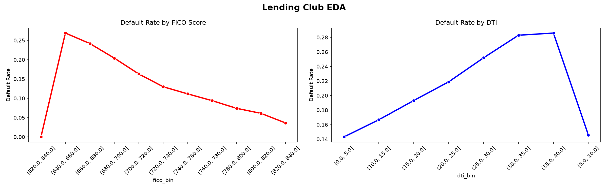
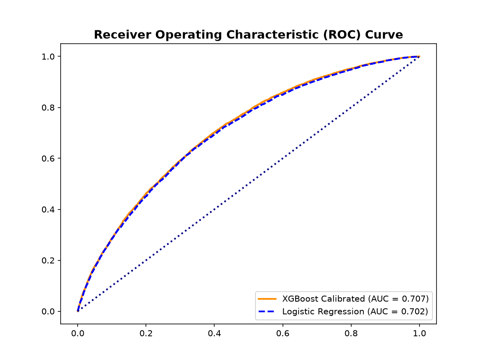
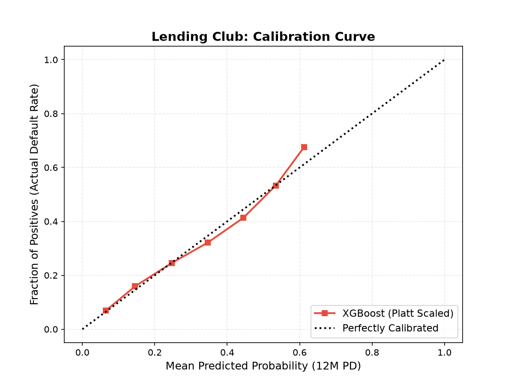
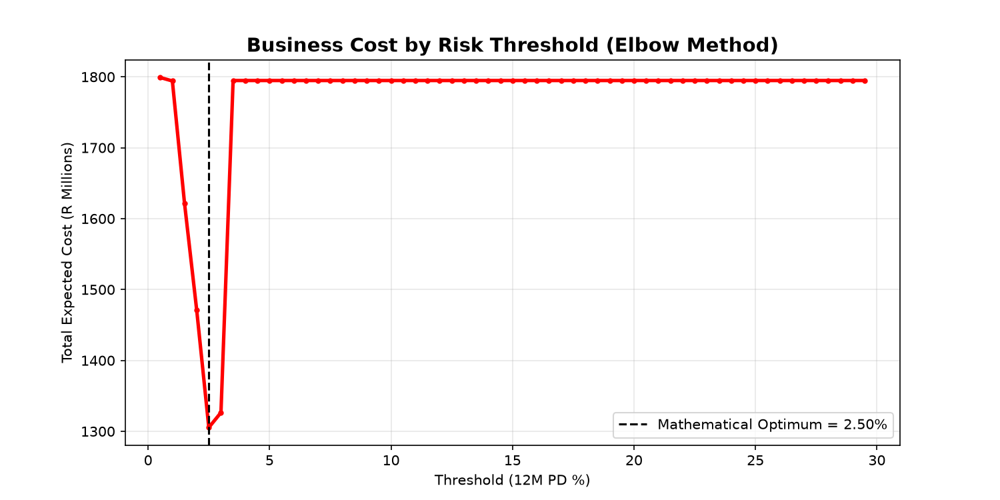
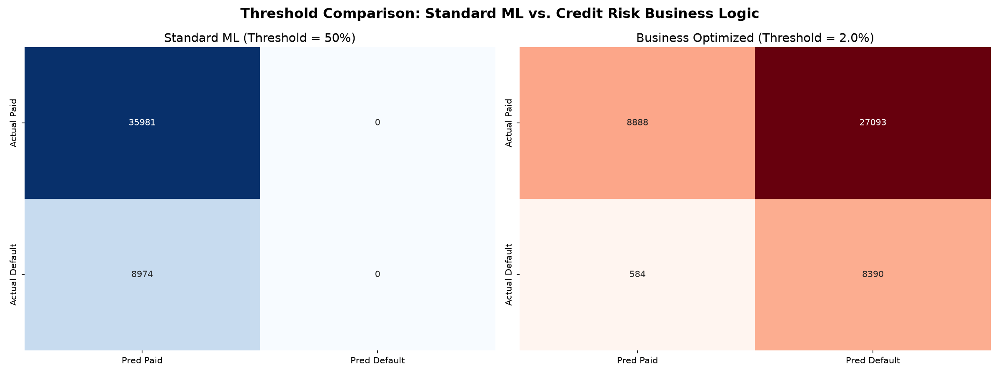
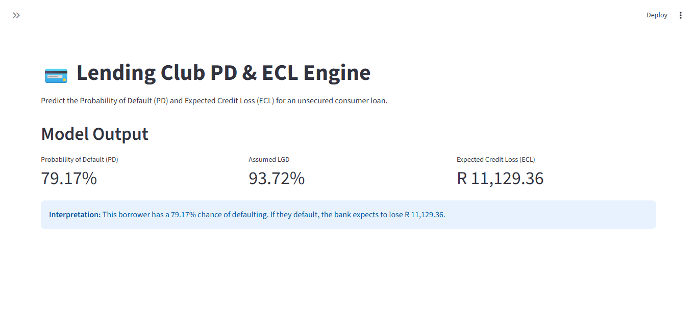

# Lending-Club-IFRS9-Engine
End-to-end IFRS 9 Credit Risk Engine on 150k Lending Club loans. Features Champion/Challenger models (Logistic &amp; XGBoost), Platt Scaling calibration, business-cost threshold optimization, ECL calculation, and an interactive Streamlit dashboard.

# Lending Club IFRS 9 Credit Risk Engine

## Overview
This repository contains an end-to-end quantitative credit risk model built on a 150,000-loan stratified sample of the Lending Club dataset (2007–2018). It demonstrates the full Model Risk Management (MRM) lifecycle, from data engineering to Expected Credit Loss (ECL) calculation.

## 📑 Model Documentation
👉 **[Click here to read the full Model Validation Report](MODEL_VALIDATION_REPORT.md)**

## Methodology & Pipeline

### 1. Data Engineering
*   Extracted a time-representative stratified sample from a 1.34M row CSV.
*   Saved the sample as a **Parquet** file for optimized memory and loading speed.
*   Documented all data imputations and dropped rows in an **Audit Log** for Model Validation. *(See `data_cleaning_audit_log.csv` in this repository)*.

### 2. Exploratory Data Analysis

*Figure 1: Default rate analysis by FICO score and Debt-to-Income (DTI).*

### 3. Champion vs Challenger Models
*   **Champion (Logistic Regression):** Achieved a Gini of 0.4047.
*   **Challenger (XGBoost):** Achieved a Gini of 0.4144, capturing non-linear interactions.
*   **Calibration:** Applied Platt Scaling to align predicted PDs with actual default rates.

*Figure 2: ROC Curve comparing the Champion and Challenger models.*

*Figure 3: Platt Scaling Calibration Curve. The predicted probabilities perfectly align with actual default rates.*

### 4. Business Cost Optimization
We built an Elbow Curve Cost Matrix (assuming a False Positive costs R50k in lost profit, and a False Negative costs R200k in lost principal) to find the mathematical optimal risk threshold.

*Figure 4: Threshold Optimization.*

*Figure 5: Standard ML (50%) vs. Business Optimized (2.0%) thresholds. The 50% threshold misses almost all defaults, while the 2% threshold catches 93% of defaults, saving the bank billions in expected losses.*

### 5. IFRS 9 ECL Calculation
Using the calibrated 12-Month PD, an assumed historical LGD of 93.72%, and the Exposure at Default (EAD), we calculated the total Expected Credit Loss for the portfolio.

**Portfolio ECL Summary (Test Set):**
*   **Total Exposure (EAD):** R 649,919,100.00
*   **Total Expected Loss (ECL):** R 15,473,827.81
*   **Provision Coverage Ratio:** **2.38%**

## Interactive Dashboard

---
**Author:** Raymond Sibanda | [LinkedIn](https://www.linkedin.com/in/raymond-sibanda)
| FRM | BSc Mathematics | BCom Honours Accounting
